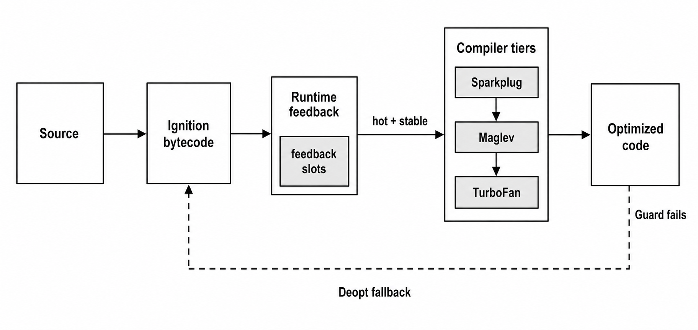

# V8 JavaScript Engine in Node.js: Architecture, Tiers, Shapes, and Deoptimization

The V8 engine owns JavaScript execution, garbage collection, object layout, and JIT code generation. Node wraps it with system APIs, but the JavaScript inside your functions still runs under V8's rules. Those rules count most when ordinary code becomes hot.

> [!IMPORTANT]
> Hot code means code that runs a lot while your app is handling requests or events. For example, let's say you have a request handler:
>
> ```js
> app.get("/users", async (req, res) => {
>   /* some logic */
> });
> ```
>
> If `/users` gets called thousands of times, the code inside that route is **hot code**. So you can think of **hot code = code on a busy path that runs again and again.**

To generate fast machine code, V8 relies on stable object shapes, that is, hidden templates it creates behind the scenes to track an object's layout. Because JavaScript is dynamically typed, objects don't have fixed schemas. V8 solves this by tracking the order and names of properties you add. When you create multiple objects that have the exact same keys assigned in the exact same sequence, they share a "stable shape." This predictability allows V8's inline caches to bypass expensive lookups and access memory locations almost instantly.

Also, passing mixed shapes into a function, changing array element kinds, using the `delete` keyword, manipulating the `arguments` object, or introducing repeated type changes disrupts this stability. These actions shatter V8's assumptions, forcing execution back down into lower, slower runtime tiers. While this process (known as deoptimization) preserves the correctness of your code, a hot path pays a massive performance penalty for losing its optimized code.

This chapter covers exactly that: how V8 compiles JavaScript, how maps and inline caches feed the JIT compiler, how memory layout affects common operations, and which coding patterns keep your programs out of repeated deoptimization loops.

## How V8 Runs JavaScript in Node.js

V8 processes your JavaScript source text by scanning tokens, parsing syntax, and generating bytecode for its interpreter, **Ignition**. As Ignition runs this bytecode, it actively records runtime feedback on your code's real-time behavior while tracking property lookups, function calls, math operations, array access patterns, and object shapes.

V8 uses this feedback to decide when code should scale up through its execution tiers or not.

First, **Sparkplug** quickly steps in to emit baseline machine code. If the path stays busy, **Maglev** leverages the gathered feedback to produce mid-tier optimizations. Finally, for the absolute hottest paths, **TurboFan** spends the extra compile time to generate highly specialized, high-performance machine code.

If your code later changes behavior and violates the strict assumptions built into that specialized code, V8 instantly deoptimizes and drops back down to a lower tier to keep running correctly.

## V8 JavaScript Engine Architecture

The execution pipeline moves linearly from raw source text to highly optimized machine code, backed continuously by memory management. You can think of the path like this:

```text
Parser -> Ignition -> feedback -> Sparkplug/Maglev/TurboFan -> deoptimization -> GC/object layout
```

It begins at the parser, which translates your JavaScript source code into internal structures. From there, the Ignition interpreter takes over to execute the resulting bytecode while simultaneously logging detailed behavioral feedback directly into slots attached to the function.

This accumulated runtime feedback is then read by V8's optimizing compilers — Sparkplug, Maglev, and TurboFan — each investing progressively more compilation effort to generate faster code. The highly specialized machine code they produce relies on strict guards protecting specific assumptions about object maps, element kinds, call targets, and value representations.

The moment a dynamic change causes these guards to fail, deoptimization triggers and shifts execution safely back down to a lower tier.

Beneath this entire pipeline sit garbage collection and object layout, managing the V8 heap model where everything in your code must ultimately live. It is easiest to understand how V8 manages this underlying heap space if you break it down into these five operations:

1. **Tracking object shapes** groups similar objects together by mapping out the exact layout and order of their properties.
2. **Handling property stores** physically writes and updates your data at precise memory locations whenever an object key is assigned.
3. **Managing array transitions** dynamically reorganizes memory on the fly the moment a collection shifts from pure integers to a mix of types like strings.
4. **Allocating closures** reserves permanent heap space for inner functions that need to keep variables from their outer scope alive.
5. **Housing boxed numbers** wraps decimals and large values into dedicated memory objects, since only small integers can fit directly into standard pointers.



*Figure 1.1 — V8 starts with bytecode execution, records runtime feedback, spends heavier compiler work on hot paths, and falls back when optimized assumptions stop matching.*

## A Deoptimization Case

Let's look at a common production failure mode, based on a real-world scenario. An API endpoint was responsible for processing configuration objects. It took a base setup, layered on user-specific overrides, and finally applied request-specific settings. The code was short and correct.

However, after a recent deployment, the CPU usage for this endpoint spiked dramatically. While the team initially suspected I/O bottlenecks — like network latency or slow database queries — the profiler pointed directly to standard JavaScript execution.

The culprit turned out to be a seemingly harmless change. A new feature introduced a single conditional property to the configuration object:

```js
if (condition) {
  config.optionalFeature = true;
}
```

Logically, this change didn't alter much. For V8, however, it completely transformed the underlying workload. Up to this point, the engine had recorded stable assumptions about the structure of the config object and had generated highly optimized machine code around that specific layout. By adding a property conditionally, the code suddenly introduced a brand-new object shape right onto the hot path.

The mistake was treating a hot-path JavaScript object as something whose structure could change freely. JavaScript does let you alter object structures at the language level. V8 relies on a much stricter internal memory layout to keep execution fast.

The engine had made a set of assumptions about the original structure of the config object. This optional property broke those assumptions, polluted the inline caches, and forced V8 to discard its optimized code path.

## Ignition, Sparkplug, Maglev, and TurboFan

Thinking of V8 as a basic line-by-line interpreter can lead to the wrong conclusions about performance. Instead, modern V8 keeps startup costs exceptionally low. It begins by observing how your code actually behaves at runtime, investing extra compilation time only after a function proves it runs frequently enough to deserve optimization.

This process always starts with parsing. V8 scans your raw source text to generate tokens, structures those tokens into an Abstract Syntax Tree (AST), and then translates that tree into Ignition bytecode — which we talked about earlier. This bytecode serves as V8's compact instruction stream, running the code inside the interpreter while feeding behavioral data to the later compiler tiers.



*Figure 1.2 — Source becomes bytecode before tiering decisions count.*

While Ignition executes this bytecode, it populates tracking slots known as feedback vectors. These vectors record the real-world behavior of everyday runtime operations. Instead of just running the code, the engine takes detailed notes on how functions are called, how math operations behave, how arrays are accessed, and how object maps shift.

For example, when V8 encounters a lookup like `obj.x`, the recorded feedback goes far deeper than just saving the property name `x`. The engine tracks the specific internal map of `obj`, the exact memory offset used to locate `x`, and whether subsequent executions continue to match that identical layout.

Once that feedback is available, hot code can move upward:



*Figure 1.3 — Current Node/V8 builds commonly expose Ignition, Sparkplug, Maglev, and TurboFan. Exact thresholds are V8 heuristics rather than a Node API.*

Sparkplug is V8's fast baseline compiler. It skips speculative optimizations entirely and compiles Ignition bytecode directly into machine code. The primary goal here is early throughput: it removes the interpreter's dispatch overhead without forcing the engine to wait for a heavy, time-consuming optimization pass.

Maglev sits right between Sparkplug and TurboFan as a mid-tier optimizer. It builds a simplified control-flow graph and uses gathered runtime feedback to specialize common operations. This allows it to compile code much faster than the peak optimizer while still delivering a solid performance boost.

TurboFan represents the peak optimizing tier. It combines bytecode with runtime feedback to generate highly specialized machine code for the absolute hottest paths. For instance, if feedback shows that a specific property lookup has repeatedly encountered the same object map, TurboFan generates code that guards that map and uses a fast, fixed-offset memory load instead of running a full, expensive property lookup.

> [!IMPORTANT]
> The most important takeaway is the feedback-driven pipeline itself. V8 takes hot JavaScript, converts it into internal representations, specializes it based on real-world behavior, and throws that optimized code away the moment its assumptions are broken.

To keep your application responsive, V8 can compile this optimized code concurrently in the background, and Node exposes controls for these concurrent systems through `node --v8-options`. However, this tiering process isn't free: gathering feedback, running guard checks, managing internal bookkeeping, installing optimized code, and recovering from deoptimizations all introduce a real runtime cost.

On-Stack Replacement (OSR) handles functions that become hot while they are actively running. For example, a massive loop might start executing in the slow Ignition interpreter, cross an optimization threshold before the function actually finishes, and hot-swap execution over to optimized machine code mid-stream.

At the end, optimized machine code is fast because it is strictly conditional. It is tailored precisely around the specific maps, element kinds, and data types that V8 has already observed. The moment a future execution violates those exact assumptions, deoptimization triggers and throws the execution back to a lower tier while reconstructing enough internal state to ensure your JavaScript still runs perfectly.

## Hidden Classes and Object Shapes
