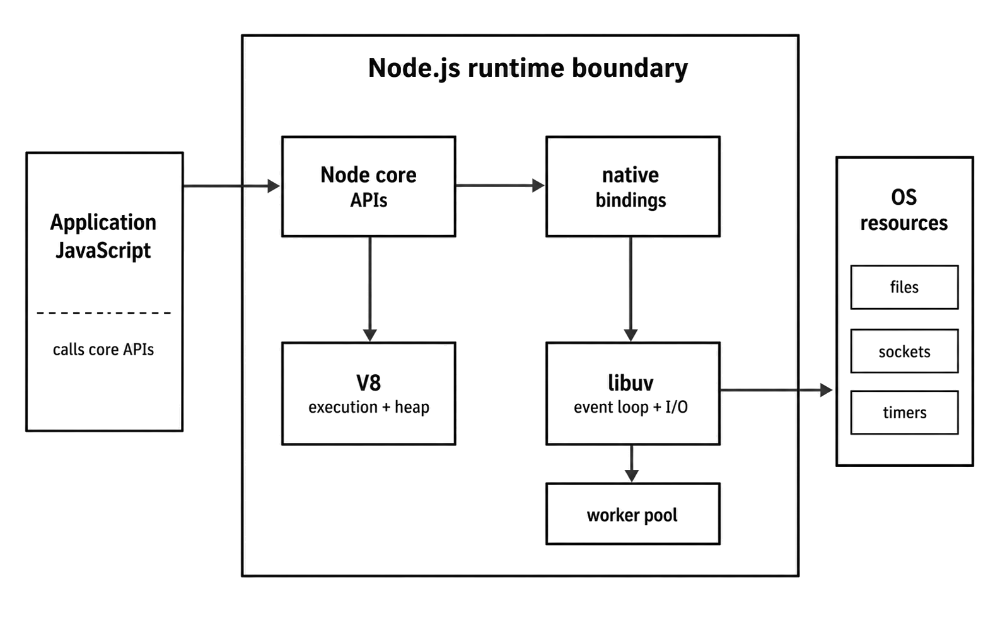
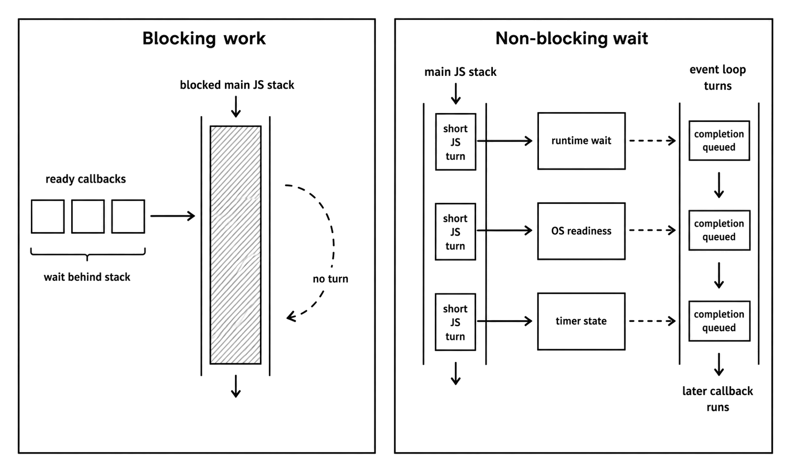
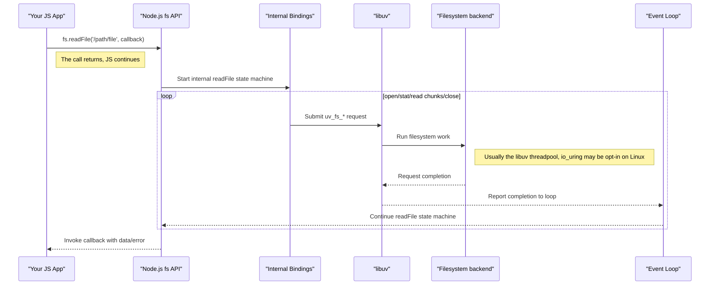

# What is Node.js?

Node.js is a JavaScript runtime for building server-side programs, CLI tools, build tools, and automation scripts. It runs JavaScript through V8, exposes system APIs through Node core, and uses libuv for the event loop, timers, operating-system I/O, and the worker pool behind file-system, `dns.lookup()`, crypto, and zlib work.

In short, V8 handles JavaScript execution. libuv tracks asynchronous work and reports when it's ready. C++ bindings connect JavaScript API calls to native code, like accessing the file system, as JavaScript has no built-in way to read or write files. Node's standard library then gives you modules such as `node:fs`, `node:net`, `node:http`, `node:crypto`, and `node:timers` as ordinary JavaScript entry points into all that machinery.

The main thread still runs JavaScript through the call stack, one frame at a time. Only one JavaScript callback runs on that thread at any moment. The waiting itself happens off the stack. A socket can wait in the operating system. File-system work can run through libuv's worker pool. Timers can sit in libuv until their deadline passes. When waiting work becomes ready, the event loop brings its callback back into JavaScript and queues it to run.

## The Four Parts of the Runtime

The runtime has four parts:

- **V8** parses, compiles, optimizes, and executes JavaScript, and manages the JavaScript heap.
- **libuv** runs the event loop, tracks handles and requests, provides cross-platform I/O primitives, and owns the worker pool used by several blocking native operations.
- **Node core APIs** expose JavaScript modules such as `node:fs`, `node:http`, `node:net`, `node:crypto`, `node:stream`, and `node:process`.
- **Userland packages** add modules on top of the runtime through npm-compatible package managers.

So, JavaScript runs on one main thread and all native work moves to the runtime. When the native side has a result, Node schedules the matching JavaScript callback or promise reaction.



*Figure 1.1 — Node core is the JavaScript-facing surface of the runtime. V8 owns execution, while native bindings and libuv connect selected host work to the operating system.*

## Runtime Architecture

### The Blocking I/O Problem

Around 2009, many mainstream web stacks still handled a request roughly like this:

- A user's request comes in.
- The server (like Apache) dedicates a thread (or a whole process) to handle that request.
- Your application code runs on that thread.
- If your code needs to do something slow — like querying a database, reading a file from disk, or calling another API — that thread blocks while it waits.
- Once the slow thing is done, the thread wakes up, finishes generating the response, sends it back, and is finally free to handle another request.

The model is easy to reason about, and for many applications it was perfectly workable. Its cost appears when a large number of requests are not using the CPU but still occupy execution slots.

In thread-per-request design, each slow request holds a thread or process until its I/O completes. High concurrency therefore means high memory use and scheduler pressure. This was the C10k problem: handling ten thousand concurrent connections on a single server without drowning in per-connection overhead.



*Figure 1.2 — Blocking work holds the JavaScript stack. Non-blocking waits move state into the runtime or operating system and return to JavaScript only when a continuation is ready.*

#### Ryan Dahl and Non-Blocking I/O

Ryan Dahl argued that this model wasted resources. The slowest parts of many web applications were I/O operations — waiting for the network, waiting for the disk, or waiting for another service. The CPU itself was often idle while the request thread was blocked.

High-performance servers such as Nginx approached the same problem with an **event-driven, non-blocking architecture**. Instead of dedicating one worker to one request while that request waits, the server registers interest in sockets and other operations, returns to the loop, and runs the completion handler only when the OS or worker pool reports progress. Node applied the same idea to server-side JavaScript to make input/output more efficient.

> The dominant pattern is to keep the main thread available while slow work proceeds elsewhere.

**Node design goals:**

- Provide a purely evented, non-blocking infrastructure to script highly concurrent programs.
- No function should directly perform I/O.
- To receive info from disk, network, or another process, there must be a callback.
- Stream everything; never force the buffering of data ... and many more.

### V8, libuv and Core Bindings

Running `node my_app.js` launches an embedded runtime around all those parts we've talked about: V8, libuv, native bindings, and Node core.

#### V8: The JavaScript Engine

V8 is Google's open-source JavaScript and WebAssembly engine, written in C++. It is the component that parses JavaScript, produces executable work, optimizes hot paths, and manages the JavaScript heap. It does not interpret source line by line; it compiles JavaScript to bytecode and may compile warm or hot paths to machine code through several Just-In-Time (JIT) tiers.

For this overview, the important point is that **V8 executes and optimizes JavaScript inside Node**. It takes a dynamic language and runs it through a modern interpreter and JIT pipeline.

But V8 does not know about Node's files, networks, modules, or timers. It is a JavaScript and WebAssembly engine, not Node's runtime. A plain V8 embedder does not provide Node's module loader or operating-system APIs. If you tried to run `require("node:fs")` inside a plain V8 context without implementing Node's loader and bindings, it would fail. To do useful server work, V8 needs an embedding runtime around it.

The engine has enough depth to deserve its own note. See [V8: The JavaScript Engine](v8-in-nodejs.md) for the parsing pipeline, JIT tiers, heap and garbage collection, isolates, and optimization behavior.

#### libuv

Another major component of Node is libuv, the C library that gives Node its portable event loop, asynchronous I/O abstractions, timers, child-process support, and worker pool.

Its main responsibilities are as follows:

- **The Event Loop.** This is the main scheduling mechanism. It runs timers, polls for I/O readiness, receives completed native work, and queues callbacks across phases. When you call `setTimeout`, `fs.readFile`, or `server.listen()`, Node's native bindings hand off the work to libuv. When that work becomes ready or completes, libuv reports back to Node. Node then schedules the matching callback, or resolves/rejects the Promise path so V8 can run its queued continuation at the next microtask checkpoint.
- **Asynchronous I/O.** `libuv` abstracts the non-blocking I/O capabilities of the underlying operating system. It's not really important to remember this, but so that you know — on Linux, it uses `epoll`. On macOS/BSD, it uses `kqueue`. On Windows, it uses `IOCP` (I/O Completion Ports). JavaScript code calls Node APIs, then libuv and Node's native layer choose the platform-specific mechanism behind those APIs.
- **The Thread Pool.** Your Node/JS code runs on a single thread, but some native operations cannot be performed by the OS in a non-blocking way. If those operations ran on the main thread, they would block the event loop. This includes many file-system APIs and CPU-intensive tasks like work in the crypto and zlib modules.

To solve this, libuv maintains a small, fixed-size thread pool (defaulting to 4 threads, with an absolute max of 1024). Node exposes the startup setting as `UV_THREADPOOL_SIZE`. When you call a function that lacks a non-blocking equivalent at the OS level, such as many filesystem operations, libuv dispatches the work to its thread pool.

Network I/O works differently. It is handled directly by the OS's non-blocking mechanisms (like epoll, kqueue, and IOCP) and does not use the thread pool, allowing a single thread to handle many concurrent sockets.

Once a thread in the pool finishes its task, it reports completion back to the event loop thread, where Node eventually (not immediately) runs the JavaScript callback or promise reaction.

So, Node is single-threaded from your perspective, but it uses a few threads internally to handle specific types of work.

#### Native Bindings and Core APIs

We just said V8 and libuv are completely separate. They meet through Node's native bindings and core modules. Those bindings are how a JavaScript call can eventually become a filesystem request, socket operation, or timer registered with the runtime.

When you write `const fs = require("node:fs");`, you don't get a pure JS object. Instead, you receive a JavaScript module that has bindings to the underlying native code. When you call `fs.readFile("/path/to/file", callback)`, the simplified path looks like this:



*Figure 1.3 — A simplified `fs.readFile()` path. The JavaScript call returns before the native filesystem state machine finishes, and the exact backend differs by platform and libuv configuration.*

- The `readFile` function (callback based) in Node's core `fs` module is called.
- Node starts an internal state machine that opens the file, determines useful metadata when available, reads chunks, and closes the [descriptor](https://www.thenodebook.com/file-system/file-descriptors-and-handles).
- Each filesystem step goes through Node's internal bindings and becomes one or more `uv_fs_*` requests.
- On the common libuv path, those requests use the worker pool.
- The JavaScript code continues executing immediately. The callback-style `readFile` call has returned `undefined`.
- As each native filesystem request completes, libuv reports completion back to the event loop thread.
- Node either submits the next read step or, when the full file has been assembled in memory, invokes the submitted callback with the data or error.

Node's own docs describe `fs.readFile()` as reading the file into memory [one chunk at a time, allowing the event loop to turn between chunks](https://nodejs.org/docs/latest-v24.x/api/fs.html#performance-considerations). That makes `fs.readFile()` convenient for bounded files, but it is still an all-in-memory API at the JavaScript level. For large files, [streams](https://www.thenodebook.com/streams/foundation-of-streams) or explicit `fs.read()` loops give you better control over memory, scheduling, and throughput.

The same native bridge is why `node:http`, `node:crypto`, `node:path`, and the rest of core give you plain JavaScript APIs while still reaching OS and C/C++ capabilities. The JavaScript surface stays thin, and the native bindings do the actual OS work.

## Blocking Wait vs Timer Wait

A blocking JavaScript path occupies the only request-handling thread in that process, while a timer wait leaves the JavaScript thread available to accept more work. Both examples live in [`examples/runtime-experiments.js`](examples/runtime-experiments.js).

### Blocking Server

```javascript
import http from "node:http";

function busyWait(ms) {
  const end = Date.now() + ms;
  while (Date.now() < end) {}
}

http.createServer((_req, res) => {
  console.log("Request received. Blocking...");
  busyWait(500);
  res.end("blocking\n");
}).listen(5000);
```

This server is deliberately wasteful. The `busyWait(500)` call keeps the JavaScript stack occupied for half a second, so no other request callback can run in that process until the current one returns.

### Timer Server

```javascript
import http from "node:http";

http.createServer((_req, res) => {
  console.log("Request received. Scheduling timer...");
  setTimeout(() => {
    console.log("Timer finished. Sending response.");
    res.end("non-blocking\n");
  }, 500);
}).listen(5001);
```

`setTimeout` schedules a callback for a future turn of the event loop. It still allocates a timer handle, and that handle can keep the process alive unless you call `unref()` on it, but it does not keep the JavaScript call stack occupied while the timer is pending. In short, Node can keep the JavaScript thread available while external waits are still pending.

## Runtime and npm

Node is a runtime, but most developers meet it through npm and its packages. That package layer sits above the runtime, and it helps explain why Node became the default execution environment for so much JavaScript tooling.

### npm and the Cost of So Many Packages

Today, the npm docs describe npm as the world's largest software registry. That scale is both a strength and a risk.

- **Pro:** You can build complex applications quickly from reusable packages, including web frameworks, CLIs, build tools, database clients, test runners, and observability libraries.
- **Con:** A project can accumulate a large dependency tree. Install time, audit noise, package maintenance quality, and runtime attack surface can become a problem.

This is why serious Node projects treat dependency management as production work. Lockfiles define the artifact CI installs. Lifecycle scripts can run during install. Indirectly imported code can become build-time code, startup-time code, or request-path code depending on how the package is imported. Reproducible installs and review of new dependencies both affect runtime behavior, not only repository hygiene.

### The left-pad Supply-Chain Lessons

- **Dependencies cannot be trusted.** An `npm install` can run lifecycle scripts, and installed code runs when your application imports or executes it.
- **Indirect dependencies count.** You might not depend directly on a package, but your production build can still require it through another package.
- **Tooling and governance count.** Lockfiles, reproducible install commands, package review, registry policy, and audit tooling should be part of production Node work.

So, using small packages is not bad, but pulling in packages trades speed for dependency risk, and we as Node developers need to manage both.

### When the Runtime Shows Up

That package layer is why Node's reach now extends beyond backend services into build tools, CLIs, desktop shells, and hosted runtimes.

Node is a common choice for cross-platform CLI tools. The npm registry contains project scaffolders, code generators, migration tools, and cloud infrastructure CLIs because Node makes packaging JavaScript command-line programs direct across operating systems.

Node is supported on serverless platforms such as [AWS Lambda](https://docs.aws.amazon.com/lambda/latest/dg/lambda-runtimes.html), [Google Cloud Run functions](https://docs.cloud.google.com/functions/docs/runtime-support), and [Vercel Functions](https://vercel.com/docs/functions/runtimes). Its async I/O model fits request handlers that spend most of their time waiting on network services, but startup time and memory use still depend on dependency size, initialization work, and the hosting platform's runtime model.

## Summary

V8 executes JavaScript. libuv owns the runtime waiting points. Node core turns native capabilities into JavaScript APIs.
